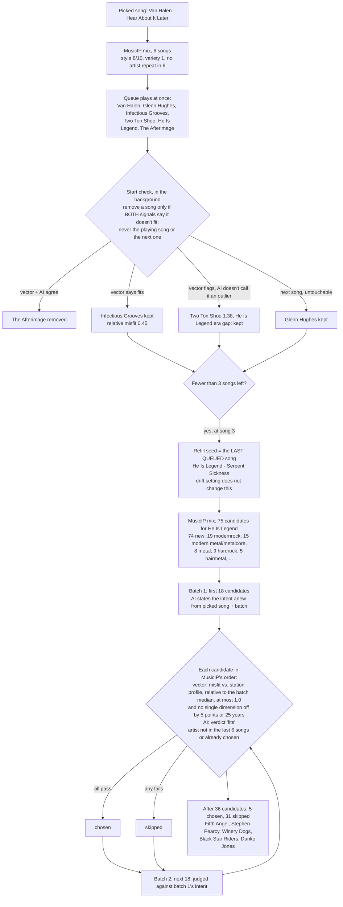

# Radio station #11 "Gritty Virtuoso Hard Rock": how its songs were chosen

Analysis of 2026-10-24. Station started 09:35:20, stopped 09:43:19 (5 songs played, the listener skipping).
Sources: the station's state and history (`radio_mode_state.json`), `kodi.log`, the rating cache, and a
reconstruction of the vector checks with the add-on's own code (`mixassist.assist.analyze`) against the same
ratings. The AI's individual verdicts are not stored (only the songs removed at the start and the first 10 skipped
in a refill, with reasons); where a verdict is inferred, it says so. MusicIP's mixes vary a little between requests
(variety 1), so the reconstructed candidate lists match the live ones closely but not exactly.

## The goal and the result

**Goal:** a dedicated station of songs like the picked song, Van Halen "Hear About It Later" (Fair Warning, 1981):
80s hard rock/metal, bluesy, gritty, anthemic. The library has plenty of that.

**What the station queued (in order):**

| # | Song | Folder | How it got in |
|---|---|---|---|
| 1 | Van Halen - Hear About It Later | #hardrock | the picked song |
| 2 | Glenn Hughes - Second Son (1999) | #hardrock | MusicIP start mix; the start check never touches the next song |
| 3 | Infectious Grooves - Good for Nothing (1999, funk metal) | #rock | MusicIP start mix; kept by the start check |
| 4 | Two Ton Shoe - Troopy's Blues (1997, bluesy stoner) | #funky_bluesy | MusicIP start mix; kept by the start check |
| 5 | He Is Legend - Serpent Sickness (2006, post-hardcore) | #modernrock | MusicIP start mix; kept by the start check |
| – | The Afterimage - Floodgates (2018, djent/metalcore) | #metalcore_modern | MusicIP start mix; **removed** by the start check |
| 6 | Fifth Angel - Empire of Hate (2023) | #hardrock | refill seeded from He Is Legend, checked |
| 7 | Stephen Pearcy - U Only Live Twice (2018) | #hairmetal | same refill |
| 8 | The Winery Dogs - The Red Wine (2023) | #hardrock | same refill |
| 9 | Black Star Riders - What Will It Take? (2019) | #hardrock | same refill |
| 10 | Danko Jones - Dance (2003) | #hardrock | same refill |

Songs 3–5 are the ones that clearly miss the goal. The refill (6–10) is hard rock, but modern-era productions,
taken from a pool that MusicIP built around song 5, not around the picked song.

## Settings in force

| Setting | Value | Effect |
|---|---|---|
| Station openness | **Focused** (strictest) | vector limit 1.0 (relative misfit), AI verdict must be "fits" |
| Station drift | **Stay close to the picked song** (strictest) | the profile never moves; the AI judges against the picked song |
| MusicIP style | **8 of 10** (style=160) | not the strictest; 10 = 200 |
| MusicIP variety | 1 | |
| No artist repeat within | 6 songs | |
| Start size (AI Mix Assist on) | 6 songs | `RADIO_ASSISTED_START_SIZE` |
| Refill | 75 MusicIP candidates, 6 songs chosen | `RADIO_CHECK_SIZE`, `RADIO_CHECKED_BATCH` |

The station was started as a new station (global settings) and saved as favourite #11 afterwards; its favourite
settings are the same (openness 0, drift 0).

## The decision tree

### 1. The start: an unchecked MusicIP mix

With AI Mix Assist on, a station starts with a plain MusicIP mix of 6 songs and plays at once (principle: no
waiting for the AI). MusicIP compares audio; it has no notion of "80s", "bluesy" or "hard rock". For this seed
its mix brought a funk-metal, a bluesy stoner, a post-hardcore and a djent song.

What MusicIP offers for this seed at all (75 songs, reconstructed): 13 #hardrock, 2 #hairmetal, 8 #metal, against
22 #modernrock, 10 #modernmetal, 8 #metalcore_modern, 4 #rock, 3 #funky_bluesy and a few others. **MusicIP's
neighbourhood of this song is mostly modern rock and metal.** Everything after this point can only choose from
what MusicIP offers.

### 2. The start check: lenient by design

The start check (`check_radio_start` → `tidy_up(..., find_replacements=False)`) rates the songs, lets the AI state
the intent from the seed and judge the songs, and measures each song's vector misfit. It **removes a song only
when both signals agree** that it doesn't fit, and never the playing song or the next one. Reconstructed vector
side (limit 1.0 at Focused; misfits relative to the median of these 6 songs):

| Song | Relative misfit | Single dimension off | Vector says | Outcome |
|---|---|---|---|---|
| Glenn Hughes - Second Son | 1.00 | – | fits (at the limit) | kept (next song: untouchable anyway) |
| Infectious Grooves - Good for Nothing | **0.45** | – | **fits** | kept, whatever the AI said |
| Two Ton Shoe - Troopy's Blues | 1.38 | – | doesn't fit | kept: the AI did not call it an outlier (inferred) |
| He Is Legend - Serpent Sickness | 0.89 | sounding year (2006 vs. 1981) | doesn't fit | kept: the AI did not call it an outlier (inferred) |
| The Afterimage - Floodgates | 1.26 | sounding year (2018) | doesn't fit | **removed** (AI: "polyrhythmic djent breakdowns...") |

Why Infectious Grooves looks like Van Halen to the vector check: the album ratings are nearly the same (energy 8 vs.
8, exploration 4 vs. 4, hand-played 0 vs. 0, form 7 vs. 8, production 6 vs. 5; mood 7 vs. 5, 1993 vs. 1981). The
eight dimensions describe energy, mood, making, production, form and era, **not the idiom** (funk slap bass,
post-hardcore vocals). And the seed weights, which measure what is unusual about the seed in this library, give
mood almost no weight (0.38; energy 2.06, era 1.46, production 1.35), so the mood difference barely counts.

### 3. The refill seed: the last queued song, whatever the drift

When fewer than 3 songs are left, the service refills (`refill_radio_queue`). Its MusicIP seed is **the last
queued song**, here He Is Legend, a song the start check had let through. "Stay close to the picked song" changes
only what the candidates are measured against (the profile and the AI's reference song), **not where the
candidates come from**. This is by design (concept: "the AI judges against the song the refill is seeded from, or
the picked song when the station stays close"), and it is the single largest cause here: one leaked song at the
end of the start mix moved the whole candidate pool.

### 4. The refill pool

MusicIP's 75 songs for He Is Legend (74 new to the station; reconstructed: 19 #modernrock, 8 #modernmetal,
7 #metalcore_modern, 8 #metal, 9 #hardrock, 5 #hairmetal, 3 #metal_funk, 4 #rock, ...). The refill check examines
at most two batches of 18 (`max(3 × count, 10)`), so 36 candidates, in MusicIP's order.

### 5. The refill check: strict, but relative to a poor pool

`choose_additions` takes a candidate only if every test passes:

1. **Vector:** relative misfit against the station profile (the picked song's rating) at most 1.0. The misfit is
   scaled twice by the batch itself: by the batch's spread per dimension and then by the batch's median misfit.
   So "1.0" means "no further from the picked song than the typical candidate of this batch". **In a pool that
   is far away, about half of it still passes.** The vector check is not an absolute distance.
2. **Single dimension:** no dimension off by 5 points or more, the sounding year not off by 25 years or more. For
   a 1981 seed this rejects nearly every song that sounds 2006 or later. In this refill it was the strongest
   filter: it rejected Accept (2010), Stone Sour (2013), Phil Campbell (2020), Feed the Rhino, Rise of the
   Northstar, Overkill (2017) and others.
3. **AI verdict "fits"** (Focused rejects "borderline"). This caught what the vector check let through: Infectious
   Grooves "Citizen of the Nation" (vector 0.44, AI: "funk-slap grooves and goofy humour"), Puya (vector 0.68,
   "salsa rhythms"), He Is Legend "Mushroom River" ("quirky post-hardcore").
4. **Artist** not among the last 6 queued songs nor already chosen (the picked song's artist included, so no more
   Van Halen).

Result: 5 of 36 passed, all from #hardrock/#hairmetal, but with production years 2003–2023 (their ratings sound
"80s" enough to pass the era rule). The station got hard rock, but neither the classic records nor the bluesy,
gritty early-80s sound.

Note on the skipped list in the station information: it shows the AI's reason where there is one, also when the
song failed on the vector or era test. "Accept - Wanna Be Free: Traditional riff-driven heavy metal, anthemic and
organic" reads like praise; the AI had called it borderline (reasons are only given for borderline and outlier),
and the era rule rejected it too. The list doesn't say which test failed.

## What the library offers that the station never saw

The rated albums closest to the picked song (library-wide scale, the same weights), going by their rating
descriptions: NWOBHM and Teutonic heavy metal, Guns N' Roses *Appetite for Destruction*, AC/DC *Powerage* and
*Back in Black*, Snow, Sunset Strip sleaze and shock-rock albums, early-80s US metal with shred guitar ("Halford's
shrieks", "Noddy's roaring", "Jon Oliva's snarling vocals"). The 40 closest are all within a misfit of 0.46. Apart
from *Fair Warning* itself (its songs are blocked: same artist as the picked song), **none of the 40 is among
MusicIP's 75 songs for the picked song, nor among the 75 for He Is Legend** (two requests each). Only 3,816 albums
of the library are rated so far (about 30 %), so there are more.

## Causes, most important first

1. **The refill is seeded from the last queued song, also at "Stay close".** One leaked song (He Is Legend) moved
   the candidate pool to modern rock and metalcore.
2. **The start mix is checked leniently** (removal needs both signals; the next song is untouchable), so leaks
   like songs 3–5 are expected, and the last of them seeds the first refill.
3. **MusicIP's audio neighbourhood of this seed is mostly modern rock/metal**; the station can only choose from it.
   The AI can reject, not find.
4. **The vector check is relative to each pool**, so it narrows a bad pool to its better half instead of rejecting
   it; and its 8 dimensions don't capture idiom (funk metal ≈ Van Halen), with mood weighted down for this seed.
5. **MusicIP's own style setting was 8 of 10**, not its strictest.
6. Minor: each refill restates the intent from the picked song plus the batch, so the wording changes between
   refills (the start check's and the refill's intent differ slightly).

## Options

Built on 2026-10-24: the first two, in this form: the start check holds the first songs and MusicIP's 75
songs for the picked song to the "More like this" rule (what fits becomes the station's next songs, the next song
included unless the playing one is about to end); refills are seeded from the last song that passed a check, else
the picked song, for every drift setting.

| Option | Effect on this station | Cost |
|---|---|---|
| **At "Stay close", seed refills from the picked song**, or rotate among the picked song and songs that passed a checked refill | the pool stays in the picked song's neighbourhood (13 #hardrock instead of 9, far fewer metalcore) | small change in `refill_radio_queue` |
| **Hold the start mix to the refill rule**: start with the picked song plus a checked selection from MusicIP's 75 (the first song plays while the check runs) | songs 3–5 would most likely not have been queued | the second song waits for the check (about 1 minute); the picked song covers it |
| **An absolute ceiling at Focused/Close**: also require a misfit within a fixed distance on the library's scale, not only relative to the pool | a far pool yields fewer songs instead of its "better half" | needs calibration |
| **Candidates from the rating space**: add the closest rated albums' songs (the list above) as candidates next to MusicIP's | reaches AC/DC, GN'R, NWOBHM records MusicIP doesn't offer | larger feature; only rated albums (30 %) |
| **MusicIP style 10/10 for focused stations** | MusicIP's own tightest mix | tie MusicIP's style to Station openness, or a per-station setting |
| **Say which test rejected a song** in the station information (vector, era, AI verdict) | easier to judge the station | small |

## Reproducing

The reconstruction script (read only: Kodi JSON-RPC, MusicIP, a copy of `ratings.db`) and its output were kept in
the session's scratch folder (`station11_analysis.py`, `station11_analysis.json`).
