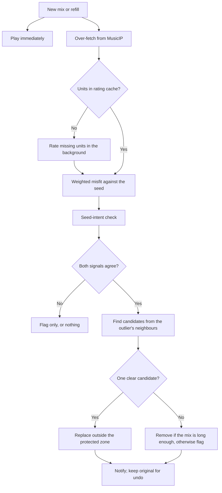

# AI Mix Assist Concept

Status: **being built** on the branch `ai-mix-assist`. The concept is backed by a pilot (`tools/style_pilot` on the
branch `style-pilot`), which developed it under the working title *style consistency*.
Terms are defined in [glossary_ai_mix_assist.md](glossary_ai_mix_assist.md).

## In one sentence

**AI Mix Assist keeps a mix true to what its first track is about:** it finds tracks that don't fit and replaces
them with fitting ones, automatically for new mixes, Radio and "More like this", and on request for saved mixes.

## How it appears to the listener

| Place | Wording |
|---|---|
| Settings category | **AI Mix Assist** |
| Settings | "Keep new mixes on track", "Keep 'More like this' on track" (later: "Keep Radio on track"): on/off (default: on). "Show only" was dropped on 2026-10-15: it only listed misfits and left the listener to act; the mix history and Undo cover "what did the AI do". |
| Notification | "AI Mix Assist: 3 tracks didn't fit and were replaced" |
| Context menu of a saved mix | "Tidy up with AI Mix Assist" |
| The seed intent | "**What this mix is about:** dark, abstract, instrumental, …", stated by the AI, with "Edit" |
| Undo | "Undo AI Mix Assist changes" |

Internal terms (*refinement*, *style check*, *seed intent*) are kept in code and in this document; the glossary maps
them to the wording above.

## Problem

MusicIP builds mixes by comparing the audio. It is good at sonic similarity (timbre, tempo, density) but blind to context: style, mood, era, scene. Depending on the seed, a mix can contain tracks that sound similar but belong somewhere else, such as Austrian disco in an avant-jazz mix or hard rock in a synth-pop mix.

The add-on's existing style controls don't solve this. MusicIP's style preference helps only moderately: at its maximum, mixes are measurably closer to the seed, but on average 43 % of the tracks still deviate strongly (see *Results so far*). The files' genre tags are too inconsistent to filter by (2,079 distinct values in this library), so "Restrict to seed genre" was removed from the add-on.

## Idea

**The seed carries the intent of the mix.** An AI rates each unit (album or compilation track) on a few independent dimensions, from its knowledge of the music. A track is compared with the seed, weighted towards the dimensions on which the seed is unusual: those are what the seed stands for. A track that deviates strongly from the seed where it matters is an outlier and is replaced.

A second, independent signal asks the AI directly: it states the seed's intent in words and judges every track against it. Only when both signals agree is a track changed without asking.

Division of labour:

| Layer | Covers |
|---|---|
| **MusicIP** | fine sonic similarity, including sub-genre distinctions such as djent vs. traditional progressive metal |
| **8 dimensions** | the coarse musical, emotional and cultural frame |
| **Seed-intent check** | context nobody defined: the "right values, wrong world" cases |

## Principles

0. **As little interaction as possible.** By default the assistant works automatically; the listener only sees
   notifications and can undo.
1. **Playback starts immediately.** No new mix and no radio station waits for an AI call. ("More like this" may
   wait: its submix is checked before it is inserted.)
2. **Saved mixes change only on demand.** Changes made while a mix is created are announced and can be undone.
3. **Act on the available facts.** When both signals agree, the track is replaced, also when the AI knows the music only from hints (artist, titles, year). A wrongly removed track costs little: a replacement is fetched.
4. **General.** Nothing depends on how a particular library is organized: no genre folders, no genre tags as structure.
5. **Rated on demand, cached forever.** Only units that appear in mixes are rated, and each unit only once per prompt version.

## Dimensions (version 2)

Seven scales from 0 to 10 plus the sounding year. The labels are the slider steps.

| Dimension | 0 | 2.5 | 5 | 7.5 | 10 |
|---|---|---|---|---|---|
| **energy** (calm ↔ intense) | still | gentle | steady | driving | ferocious |
| **exploration** (conventional ↔ exploratory) | conventional | familiar | inventive | adventurous | radical |
| **mood** (dark, tense ↔ bright, playful) | bleak | brooding | bittersweet | sunny | exuberant |
| **making** (played by hand ↔ programmed) | hand-played | mostly played | mixed | mostly programmed | machine-made |
| **danceability** (not for dancing ↔ made for dancing) | for listening | swaying | groovy | danceable | dancefloor |
| **production** (raw, gritty ↔ polished) | raw | rough | natural | clean | glossy |
| **form** (instrumental, open ↔ vocal song) | open | instrumental | loose | song | vocal-led |
| **sounding year** | early (≤1964) | classic (1965–79) | eighties | turn of millennium (1990–2009) | contemporary (2010+) |

Each step has anchor artists from the library, and each dimension says what it is not (e.g. danceability is not energy: house can be mellow, disco is played by hand). Definitions and anchors are in `tools/style_pilot/dimensions.py`.

### How they were chosen

The first set of 8 was a reasoned guess. It turned out to count energy three times (intensity, anthemic, presence) and mood twice (darkness, temperature), and it had nothing for production or form, which were the most frequent reasons in the AI's own judgements.

A **dependency study** then rated the pilot's albums on 22 sharpened candidates (all rated with r 0.93–0.99 in a repeat) and looked for dependencies:

| Independent axis | Candidates that measure it |
|---|---|
| energy | energy, heaviness, aggressiveness, intimacy ↔ anthemic, density, presence |
| exploration | harmony, progressiveness, rhythmic complexity, accessibility (inverted) |
| mood | darkness, playfulness, warmth, tension |
| making | performance (played or programmed), timbre, danceability |
| production | polish |
| form | vocal role, song form, improvisation |
| sounding year | sounding year |

Version 2 takes one dimension per axis, rated directly as one concept each (they agree with their axes at r 0.90–0.97), and adds **danceability** as its own dimension: it parts from "programmed" exactly where it matters, in hand-played dance music such as disco. Version 2 behaves like 5.7 independent dimensions out of 8; the first set like 4.4.

## Results so far

| Test | Result | Consequence |
|---|---|---|
| **Stability** | Repeated ratings agree with r 0.90–0.99, also for music the AI doesn't know. | Ratings made at different times can share one cache. |
| **Compression** | The AI avoids the ends of the scales: most albums land in the middle three steps. | Place slider labels by **library percentiles**, not at fixed values. |
| **Genre tags** | Without them, unknown music is rated about as before on average, but about 5 % is misread as a different style altogether. | Keep the genre tag as a rating hint. |
| **Dry runs on 5 real mixes** | The weighted misfit and the seed-intent check agree closely: AUC 0.95–1.00 (holistic outlier vs. fits) per mix. On the first mix, against the user's verdicts: 0.97. | The dimensions reproduce the holistic judgement. |
| **Threshold** | A fixed misfit threshold doesn't transfer between mixes; 1.2 × the mix's median misfit does (33 of 47 holistic outliers caught, 1 of 70 fitting tracks flagged). | Flag relative to the mix. |
| **Seed weighting** | Unweighted, the new dimensions agree worse with the user's verdicts (0.78) than weighted (1.00). | Weighting by the seed is essential. |
| **MusicIP's style preference** | 6 seeds at style 0, 100 and 200: mixes get closer to the seed with higher values (misfit 1.68 → 1.39; tracks far from the seed 54 % → 43 %; from the seed's genre folder 11 % → 29 %). Genre tags play no visible role (tracks sharing the seed's tag: 8 % → 13 %). | Keep the setting as it is; it improves the raw material that refinement works on. |
| **Replacement** | In four mixes, all 19 outliers were replaced (12 from neighbour submixes, 7 from the master seed's submix); the user found the refined mixes' consistency convincing. With submixes seeded from merely non-outlier neighbours, 3 gaps had stayed empty. | Seed submixes only from clearly fitting tracks; keep the master-seed fallback. |
| **Mainstream reference for "unusual"** (2026-10-17) | 150 well-known albums, balanced over 15 genre families and seven decades, rated by the AI with the same prompt. Against the library (1,891 units) the mainstream is a little brighter (mood 5.0 vs. 4.6), more danceable (4.4 vs. 3.6), more polished (production 7.0 vs. 6.4) and older (1989 vs. 1995): differences of 0.2-0.5 spreads. Seed weights shift moderately (Manowar: mood 0.39 -> 0.61, sounding year 0.92 -> 0.49). Agreement with the AI's verdicts on the pilot's 5 mixes is unchanged (AUC 0.95-1.00 either way; the user's verdicts 0.97 -> 0.98), but the 1.2 limit then flags 5 fitting tracks instead of 1 and catches fewer outliers in the first mix (10 vs. 17 of 26). China Grove on the Manowar station: 1.13 -> 1.08. | Keep the library as the basis for "unusual". The library is close to the mainstream on these scales; the start check's miss comes from the small, scattered batch and the both-must-agree rule, and the AI's judgement (which knows the mainstream) caught it. |
| **Non-linear distance** (2026-10-17) | The distance already squares each dimension's deviation (root mean square, with the correlation correction). Tested on the same benchmark: squared without correction, cubic (of the size), cubic with sign, 4th power, maximum, and "tolerance of one spread, then squared". With sign, opposite deviations cancel out (AUC down to 0.83, 11 fitting tracks flagged). Ranking ability is about the same (AUC 0.95-1.00; maximum worse, 0.90-1.00); the stronger the non-linearity, the more fitting tracks the 1.2 limit flags (today 1 of the pilot's fitting tracks; squared 4, cubic and 4th power 6, maximum and tolerance 10) for about as many outliers caught (30-36 of 47). China Grove ranks 2nd or 3rd farthest of the station's first songs in every variant. | Keep today's distance. A stronger non-linearity acts like a stricter limit, not like a better measure; the correlation correction is what keeps false flags low. |
| **Single-dimension rule** (2026-10-17) | An extra profile flag when one dimension alone is clearly off, in addition to the overall 1.2 x rule. Measured in the mix's weighted spreads it misfires (fitting tracks reach 8.5 spreads where a mix's spread is small): 21-44 fitting tracks flagged. On the plain scale (one dimension at least N points apart, or the sounding year Y years): >= 5 points / 25 years catches 45 of the AI's 47 outliers (today 36) and all 9 of the user's (today 7), with 2 fitting tracks flagged (today 1); >= 4 points / 20 years flags 26 fitting tracks. Restricting it to the dimensions that characterise the seed changes nothing. China Grove differs by 4 points at most (danceability), so 5 points don't catch it; Boom Crash Opera (5) is caught. | Built (2026-10-17): "one dimension >= 5 points or the sounding year >= 25 years apart" is a second profile flag, everywhere the profile check runs. Tidy-ups still need the AI to agree; new tracks must not have such a miss. |

The pilot also used this library's genre folders as ground truth (38 % of albums nearest to their own folder, chance 2 %). That is a development tool, not part of the design.

## Rating

### Units and keys

- A **normal album** is one unit; all its tracks share the rating.
- A **compilation track** is its own unit, because its album says little about it.
- The **unit key** is the MusicBrainz release-group ID (album) or recording ID (track). Release-group IDs merge editions and remasters, and both kinds of ID absorb spelling variants of artist names. Without IDs, the key is the normalized artist and title.

### Input and output

- **Input:** artist, album or track title, year, up to 15 track titles (albums), and the genre tag as a hint. Never file paths, folders or audio.
- **Output:** the 8 values, familiarity (0–2) and a short description (15 words at present).
- Structured output enforces the format. Values are clamped to their ranges.

### Cache

- SQLite in the add-on profile, keyed by unit key (a JSON file in the pilot).
- Each entry stores the values, familiarity, description, model, prompt version and rating time.
- When the dimension definitions change, the prompt version changes, and old entries are re-rated when next needed.

### Routes

| Route | Use | Cost (pilot figures) |
|---|---|---|
| **Subscription** (Claude Code CLI, claude.ai login) | rating on demand on the machine running Kodi | counts towards the plan's usage limits (~$0.15 list-price equivalent per 20 albums) |
| **API direct** | rating on demand where no CLI is available | standard price, about $0.003 per unit |
| **API batch** | bulk rating, experiments | half price, about $0.0016 per unit; takes up to an hour |

The subscription route must not pass `ANTHROPIC_API_KEY` to the CLI, or the calls are billed to the API account. It must not use the CLI's `--bare` mode either, which forces API-key billing.

## Fit

### Weighted misfit against the seed

1. **Reference:** the seed's style vector. Finished mixes are always judged against the seed (drift 0; see *Drift*).
2. **Seed weights:** each dimension is weighted by how far the seed is from the library average, in library standard deviations, scaled to average 1. For an avant-jazz seed: form 2.1 (instrumental), exploration 2.0, sounding year 1.3, but energy 0.3, because the seed's energy is ordinary.
3. **Spread:** the mix's robust spread per dimension sets the scale, with a floor of 1 point (5 years for the sounding year).
4. **Misfit:** the weighted deviations combined, corrected for the remaining overlap between dimensions. The largest weighted deviations give the reason shown to the user, e.g. "exploration: familiar vs. adventurous; form: vocal-led vs. open".
5. **Relative misfit:** misfit divided by the mix's median misfit (at least 1.0). **Strictness** is the threshold on it; 1.2 is calibrated on five mixes.

### Signals and decisions

| Signal | Source | Cost |
|---|---|---|
| **Vector misfit** | rating cache | arithmetic only |
| **Seed-intent check** | an AI call: it first states the seed's intent as 5–8 musical qualities (not instrumentation or scene), then judges each track against it, with the rest of the mix as context only | one call per mix |

- **Flagged:** one signal reports an outlier. The track stays and nothing is shown; it is not used as a submix seed, and a new track in this state is not added. (Showing flagged tracks for the listener to decide was dropped with "Show only" on 2026-10-15: tidy-ups act on their own, the history and Undo show what they did.)
- **Clearly inconsistent:** both signals agree. Such tracks are replaced during refinement without asking, also when they are **guessed units** (rated from hints alone).

For a guessed unit the two signals are not independent: the seed-intent check reads the description written in the same rating. The decision is deliberate (principle 3): both guessed outliers in the first mix were right, and a wrong removal is cheap.

**Dimension weights** (per dimension: off, or how much it counts) and **target values** (the seed's value replaced by a slider position) remain possible user settings.

## Changing mixes

| Context | What happens | Automatic |
|---|---|---|
| **New mix**, including "More like this" | Plays at once. Refinement runs in the background, patches the not-yet-played part of the playlist and the saved mix, and shows a notification ("Mix refined: 2 tracks replaced"). | yes, if enabled |
| **Radio, start** | The station plays at once with 8 songs (one refill's worth; without AI Mix Assist, the mix size); in the background, its first songs (a plain MusicIP mix) lose the ones that clearly don't fit the picked song (both signals agree), never the playing song or the next one. | yes, if enabled |
| **Radio, refills** | Start when fewer than 3 songs are left, take 75 MusicIP candidates and are checked before they are queued (1–2 minutes). If the last song starts while the check still runs, MusicIP's songs are queued unchecked so the radio never stops; the check then only updates the profile. Nothing needs patching. | yes, if enabled |
| **Saved mix** | "Tidy up with AI Mix Assist" from the context menu: replaces the tracks that don't fit, records what changed in the mix information, and can be undone. | never |



### Rules for patching a playing mix

- The **protected zone** (the playing track and the next one) is never changed. Kodi may already be preparing the next file.
- Patch only if the playlist still belongs to this mix. The add-on already detects when other playback takes over (as in Radio mode).
- While the check runs, only the first track or two play, and the first track is the seed. Once the cache covers the part of the library that gets played, the vector part needs no AI call; the seed-intent check remains one call per mix.

### Replacement: a submix, like "More like this"

Replacing an outlier works like "More like this": a **submix** is created and inserted into the master mix, and the **same consistency mechanisms apply to the submix**, measured against the master mix.

1. **Submix seed:** the nearest earlier track that **clearly fits** (misfit within the strictness and the seed-intent check says *fits*), at worst the master seed. A submix inherits its seed's direction, so a borderline neighbour would pass its drift on.
2. **Submix:** about 15 tracks from MusicIP. Tracks already in the mix and repeats are dropped.
3. **Check against the master mix:** the master seed's weights, the master mix's spread and median misfit, and the master's stated seed intent (one AI call covers all candidates of a mix).
4. **Choice:** the candidate with the lowest misfit that passes both signals and does not repeat an artist within the add-on's artist window (5 tracks). Artist names are compared loosely ("&" = "and").
5. **Fallback:** if a gap's submix yields nothing, a larger submix from the **master seed** (3× the size) serves all such gaps. If that fails too, the outlier is removed.
6. If MusicIP rejects a submix seed, the next clearly fitting track further back is tried.

**When much of a mix fails** (in the first mix, half the tracks failed the seed's intent), patching turns into rebuilding: over-fetch more and keep only what fits.

### Undo and decisions

- The sidecar keeps the track list before each change, so refinement and style checks can be undone.
- Decisions per track (replace, remove, keep) were planned for a style check where the listener decides; that check was not built. Tidy-ups decide on their own; the history records what they did and why.
- All decisions (replace, remove, keep) are recorded. Over time they show which dimensions and thresholds match the listener's ears.

### Relation to repair and "Less like this"

- **Repair** remains the recovery of moved or deleted files. Style changes are curation, not recovery, so they follow the stricter rule for saved mixes.
- **"Less like this"** removes tracks similar to one the user dislikes. A style check removes tracks that don't match the seed. They complement each other and can share the decision record.

### Openness scale

Mixes and Radio use one scale with the same words, set independently ("Mix openness" for tidy-ups, new mixes and "More like this"; "Station openness" for Radio; decided 2026-10-15; named for what the listener gains, not as "strictness", and not "variety", which is MusicIP's own mix parameter). Internally a level is a strictness: the limit on the relative misfit and whether new songs the AI calls *borderline* are accepted:

| Level | Limit | New songs: AI verdicts accepted |
|---|---|---|
| Focused | 1.0 | fits |
| Close | 1.1 | fits |
| **Balanced** (default; the pilot's calibration) | 1.2 | fits |
| Open | 1.35 | fits |
| Adventurous | 1.5 | fits, borderline |

New songs (replacements, "More like this", Radio refills) must pass both signals at that level; a tidy-up removes a song only when both signals agree it doesn't fit, measured with the same limit. An earlier draft tied Radio's steps to the mix setting; dropped because mixes and Radio want different things and the coupling was hard to predict.

### Per mix (2026-10-17)

The global settings are defaults; each mix can have its own. The "Generate MusicIP mix" dialog has two more lines: **AI Mix Assist** (Off or an openness level) and **What this mix is about** (the listener's words, used instead of the AI's statement). The mix keeps them in its sidecar (`mix_assist.openness`, `mix_assist.listener_intent`); its tidy-ups and "More like this" use its openness; Off means no automatic checks (a tidy-up started from the menu then uses the default level). The saved mix's context menu has one entry, **AI Mix Assist…**: what the mix is about, openness, tidy up now, undo. Choices and changes are in the mix history. Radio keeps its global "Station openness": picking a station has no dialog.

### Names and favourite stations (2026-10-17)

When the AI first describes a mix or a station, it also names it in 2 to 4 words in the same call ("Hypnotic Cosmic Analog Voyages", "Dark Epic 80s Metal"; no artist names). Mixes are listed by that name; the information shows it with the date; stations are named without a date ("timeless"). The listener can rename a mix in its "AI Mix Assist..." menu; the listener's name is kept, an empty one goes back to the AI's. Setting "Name mixes and stations" (on). Favourite stations keep a station's picked song, name, Station openness and Station drift; they always start fresh from the picked song, with their own settings (other stations follow the global ones).

## Drift

Drift answers a different question than the style check: not *does this track belong to the mix?* but *which track should come next?* It applies when tracks are chosen one after another (Radio refills, journeys), not when a finished mix is judged.

> reference = (1 − drift) × previous reference + drift × the track that just played

| Drift | Reference | Effect |
|---|---|---|
| 0 | stays at the seed | every track must fit the start: strict |
| ~0.2 | moves slowly | gradual drift, like a radio programme |
| 1 | the predecessor | chain: only the step to the previous track counts |

The same idea in two plainer controls:

- **Step size:** how different consecutive tracks may be.
- **Leash:** how far the mix may move from the seed in total.

**As built for Radio (2026-10-15):** drift is a meandering, exploratory experience with two controls. **Station drift** (how far): the station's profile moves towards every added song in turn, with a half-life in songs, so it doesn't depend on refill size or skip rate: stay close to the picked song (never moves), drift slowly (half the way after about 60 songs, ~4 h), wander freely (after about 20 songs, ~1 h 20). The vector part measures candidates against that profile (the leash). **Station openness** (how surprising each song may be), on the same scale as mixes (see *Openness scale*); the AI judges against the song the refill is seeded from, or the picked song when the station stays close. Checked refills bring 8 songs (20–50 minutes), so that reference song moves on often and the meander stays smooth; batch size is fixed, not a setting. When nothing fits, the next refill seeds from an earlier song; when the check fails or the station is about to run dry, MusicIP's songs are queued unchecked.

**Station information (2026-10-17):** the Radio screen offers "Station information" while a station plays: Overview (settings, songs played, refills, kept/skipped), What it is about (the picked song's description, then each refill's), Drift (the profile per dimension from the picked song to now, its course over the refills, what moved most) and History. The Drift tab has a **drift chart** above its text: one line per dimension (seven scales on 0–10, sounding year on its own axis), drawn as an image (Pillow where Kodi has it, else a built-in PNG writer). The service records the events in the radio state.

**Information window (2026-10-17):** mix and station information open in the add-on's own window (`resources/skins/Default/1080i/script-musicip-info.xml`): a heading (the name), a line of facts, tabs down the left; moving onto a tab shows it, the text scrolls. Mixes: Overview | Sound | Course | Changes | History. **Sound** shows the ratings of the last check as range bars (per dimension the mix's range and its average). **Course** shows each track's ratings in mix order in one chart, as smooth curves (a monotone spline through the ratings, which doesn't swing beyond them): the seven scales on 0-10, the sounding year dashed on its own scale (right), as in the drift chart (2026-10-18); the check stores them with the mix, with a key that tells when the mix has changed since. Stations: Overview | What it is about | Drift (with the chart) | History. The text in the charts is drawn into the image with Kodi's own `media/Fonts/arial.ttf` (DejaVu Sans); without Pillow or the font the charts have no text and the tab's text carries the values. If Kodi can't show the window, the text viewer shows the same information as before.

Judging a finished MusicIP mix with drift above 0 was tested and does not work: MusicIP's track order jumps between clusters, so a gradual judgement accepted almost everything, and a chain judgement flagged the tracks *after* each jump, including the best-fitting ones. Finished mixes are therefore always judged at drift 0; transitions are a matter of ordering (see *Deferred*).

## Sidecar `style` section (sketch)

```json
{
  "style": {
    "model": "claude-opus-5-5",
    "dimension_version": 2,
    "prompt_version": "…",
    "checked_ts": 1770000000,
    "settings": {"strictness": 1.2, "weights": {}, "targets": {}},
    "seed_intent": "Freely improvised, open-ended structure; …",
    "tracks": [{"path": "…", "unit_key": "…", "misfit": 1.41, "flagged": true, "guessed": true,
                "verdict": "outlier", "reason": "exploration: familiar vs. adventurous; form: vocal-led vs. open"}],
    "changes": [
      {"ts": 1770000000, "kind": "refinement", "action": "replace", "position": 7,
       "old": "…", "new": "…", "reason": "exploration: familiar vs. adventurous"}
    ],
    "kept": ["…"],
    "previous_tracks": ["…"]
  }
}
```

## Known gaps

| Gap | Seen where | Status |
|---|---|---|
| **Acoustic ↔ electric sound** | The user rejected Crosby, Stills & Nash, Isabelle Mayereau and The Doors as "acoustic, not electronic, handmade". *Making* only distinguishes played from programmed, and timbre did not form an axis of its own in the study. | Kept in mind; axes unchanged for now. Candidate fix: *sound* (acoustic ↔ electric ↔ electronic) instead of or next to *making*. |
| **Sub-genre resolution** | In a metalcore mix, the vectors also flag pop-metalcore and djent tracks that the seed-intent check accepts. | Below the resolution of 8 coarse dimensions; the "both signals" rule prevents changes there. |
| **Threshold in failing mixes** | When half a mix is off target, the mix median is inflated and the relative threshold catches fewer outliers. | Rebuild rather than patch such mixes. |
| **Album units** | Tracks from the seed's own album share its rating, so their misfit is 0 and they always fit. | Acceptable; the artist window keeps them from landing next to the same artist. |
| **MusicIP must know the paths** | Moved files that MusicIP hasn't rescanned can't seed a submix (HTTP 500); for the first mix this blocked the master-seed fallback. | Rescan MusicIP after moving files; the replacement step skips to an earlier seed. |

## Deferred

| Idea | Reason |
|---|---|
| **Context tags** from a fixed list of settings and scenes | First step if the dry runs show context misses. |
| **Colour vector** (embedding of the description) | Needs an embedding model that Kodi can't run; likely re-encodes genre; the seed-intent check covers the same ground. |
| **MusicBrainz community genres** as a rating hint | Cleaner than the genre tag, but often missing for obscure music. Worth a pilot comparison. |
| **Folder signal** | Only for libraries organized by genre; not general. |
| **A mix like an album** | A mix now has a seed, a statement of what it is about, a mood, replaced tracks, perhaps a title: almost like the sleeve text of an album. Kodi could present a mix like a "Various Artists" album, with that text and with artwork (e.g. a collage of the albums' covers). Idea from 2026-10-14; later. |
| **Seed weights for narrow libraries** | Seed weights measure "unusual within this library". In a narrow library, the dimensions that define the listener's taste become ordinary and lose weight (simulated metal-only library: a metal seed's energy weight drops from 1.1 to 0.4), while small quirks gain weight. Remedies: measure "unusual" against a fixed, genre-balanced reference instead of the library, and raise the weight floor (e.g. 0.5). Backlog; the seed-intent check and MusicIP's library-bound candidates limit the effect meanwhile. |
| **Journey, arc, smooth ordering, map** | Build on the same reference mechanics; later. |
| **Mix from prompt** | The reverse way: from a description to a seed to a mix. The AI rates the prompt on the 8 dimensions; the closest rated albums (and matching descriptions) are seed candidates; the AI picks the album and its most typical track; MusicIP mixes; the tidy-up holds the mix to the prompt, which becomes the mix's description "in your words". Menu entry "Mix from prompt", keyboard input, a progress bar. Catch: only rated music can be found (2026-10-15: 2,417 of 12,769 albums, about 19 %); remedy: rate the whole library in small portions in the background (about 520 more calls, spread over days for the usage limit), which also speeds up tidy-ups and Radio. Next step when picked up: a spike with 3–4 prompts showing the top seed candidates from the rated albums. Backlog since 2026-10-15. |

## Build decisions (2026-10-14)

| Decision | Choice |
|---|---|
| Name | **AI Mix Assist**, branch `ai-mix-assist` from `main` |
| Automatic by default | new mixes, Radio, "More like this" ("More like this" may wait for the check) |
| On demand | saved mixes, from the context menu |
| Seed intent | stated by the AI by default; the listener can edit it |
| Description length | 15 words (unchanged) |
| Slider labels | fixed placement for now; percentile placement with the advanced sliders, later |
| Rating route | the Claude Code CLI on the listener's subscription (see *Running Claude from Kodi*); an API key as an alternative later |
| Build order | core (cache, CLI route, fit, checks) → saved mixes on demand (smallest complete slice) → new mixes → "More like this" → Radio |

## Build progress

| Slice | State |
|---|---|
| Core: rating cache, CLI route, fit, seed-intent check, tidy-up plan | built and tested |
| Saved mixes on demand: tidy up, undo, edit what the mix is about | built, tested live in Kodi (5 replacements, 138 s) |
| New mixes: queued when saved, tidied up by the service in a background thread; "show only" lists the tracks that don't fit in the mix information | built, tested live in Kodi (2026-10-15: consistent results; mixes came out short, fixed, see below) |
| Replacement search, second version: gaps sharing a submix seed share one submix, every MusicIP request asks for 75 tracks, a gap may use any candidate of its round, open gaps get a second round from other clearly fitting tracks | built and tested; dry run on the live-test mix: 7 of 7 gaps filled (before: 4 of 8), 40 of 40 tracks, about 4 minutes |
| "More like this": the selected song is the reference ("more like THIS"; it may be the seed). It and MusicIP's tracks for it form a small mix; a new track must clearly fit the song (both signals, like replacements), closest first, respecting the artist window around the insertion point; "show only" inserts MusicIP's tracks and lists the misfits | built and tested; dry runs on the live-test mix: 8 of 8 tracks for a fitting song (33 s) and for an edge song (64 s, two batches); live test pending |
| Mix history (all mixes, on `main`): created, removed by you, More/Less like this, repaired; on this branch also AI tidy-ups with reasons, tracks skipped by "More like this", undo, edited descriptions. Information in its own window with tabs and charts (see *Information window*). Progress bars for creating a mix, More/Less like this, repair and the background tidy-up | built and tested; live test pending |
| Radio: start check, checked 8-song refills, per-song drift (settings "Keep Radio on track", "Station drift", "Station openness"); without the Claude CLI Radio works as before | built and tested; live test pending |

**Decided (2026-10-15, "More like this"):** the new tracks are measured against the selected song, not the whole mix: "More like this" refers to THIS song, which may be the seed. Measured against the whole mix, a song at the edge of the mix got no tracks at all.

## Running Claude from Kodi (spike, 2026-10-14)

Tested from Kodi 21's Python (3.8.15) on Windows, inside the running add-on:

- Starting the Claude Code CLI with `subprocess` works; with `CREATE_NO_WINDOW` no console window appears (watched
  in Kodi: only the add-on's own notifications).
- Login: the claude.ai subscription (Pro). **Kodi's environment contains `ANTHROPIC_API_KEY`** (a user environment
  variable), so every call must remove it, or it is billed to the API account.
- Timing: `--version` 0.1 s, `auth status` 0.3 s, a rating call for 1–3 albums 5.5–6.6 s.
- The CLI was only available inside the VS Code extension, whose folder name contains the version (it changed from
  2.1.296 to 2.1.299 during the pilot). The add-on searches the known places (newest version first) and offers a
  path setting.
- `auth status` prints the account's e-mail address; the add-on logs only whether the CLI is logged in.

## Next steps

Updated 2026-10-17. Done since the pilot: F12, the add-on (cache, CLI route, checks for saved mixes, new mixes, "More like this" and Radio), naming, the single-dimension rule. Open:

1. **Rebuild instead of patch:** the plan already marks mixes where more than a third fails (`rebuild_suggested`), but nothing acts on it yet.
2. **Description length:** 15 words now; about 40 would keep later context features possible without re-rating.
3. **Slider labels by library percentiles:** only needed for the advanced sliders, which are not built.
4. The ideas under *Deferred*, and the known gaps (acoustic vs. electric sound, sub-genres).
